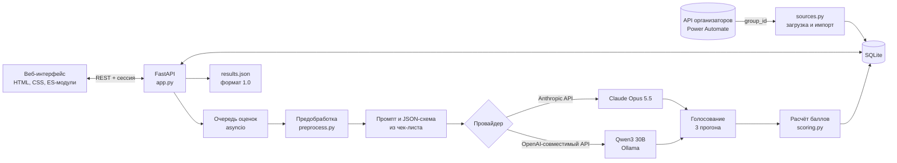

# CQA: контроль качества диалогов

Команда «Пирожки». Хакатон Freedom Broker, задача Conversation Quality Analytics.

Система оценивает работу оператора в чатах и звонках на русском, казахском и английском по настраиваемому чек-листу. По каждому критерию она выставляет ответ и баллы и объясняет решение со ссылкой на конкретную реплику. Оценку можно оспорить: проверяющий подтверждает или меняет её, и итог пересчитывается.

**Рабочий экземпляр:** https://cqa.dogslabs.org. Вход без пароля, роль выбирается на экране входа.

## Для организаторов

| Что | Где |
|---|---|
| Результаты по DEV (65 диалогов) | [`results/dev/results.json`](results/dev/results.json) |
| Результаты по контрольному набору | `results/prod/results.json`, появится в течение контрольного часа |
| Модель | Claude Opus 5.5 (`claude-opus-5-5`) через Anthropic API, `mode: external_api` |
| Стоимость оценки | около $0,04 за один прогон модели; диалог оценивается тремя прогонами, это около $0,11 с учётом кэша промпта (по фактическим расходам, `GET /api/evaluations/estimate`) |
| Локальный вариант | Qwen3 30B через Ollama: на ноутбуке или на своей машине с GPU NVIDIA L4 в Google Cloud |
| Контракт API | [`docs/API.md`](docs/API.md), интерактивная документация на `/docs` (Swagger) |

Вход без пароля: на экране входа выбирается одна из трёх ролей (клавиши 1-3). Оператор выбирает себя из операторов, найденных в диалогах, и дальше видит только свои диалоги. Роль меняется в меню пользователя; если открыт диалог, смена роли на «Оператор» входит за оператора этого диалога. Какие роли доступны, задаёт `CQA_QUICK_LOGIN_ROLES` (по умолчанию все, `none` выключает быстрый вход). Вход по паролю (`CQA_DEMO_PASSWORD`) остаётся только в API для скриптов.

| Логин | Роль | Права |
|---|---|---|
| `operator` | Оператор | смотрит свои оценки и подаёт апелляции |
| `supervisor` | Супервайзер | загружает и оценивает диалоги, подаёт апелляции, ведёт чек-лист, меняет модель оценки в настройках |
| `reviewer` | Проверяющий | запрашивает второе мнение ИИ и решает апелляции |

Апелляции решает только проверяющий, супервайзер их не решает: кто оценивает, тот не судит спор. Пользователя `admin` из старых баз сервер удаляет при запуске.

## Быстрый запуск

Нужны Python 3.11+ и [uv](https://docs.astral.sh/uv/).

```bash
uv venv --python 3.12 .venv
uv pip install --python .venv/bin/python -r requirements.txt
cp .env.example .env
cd backend && ../.venv/bin/python -m cqa
```

Впишите в `.env` ключ Claude API (`CQA_ANTHROPIC_API_KEY`) и ссылку на API организаторов (`CQA_SOURCE_URL`). Откройте http://127.0.0.1:8000, войдите как супервайзер, в «Диалогах» загрузите группу `DEV` и запустите оценку.

Тесты: `cd backend && ../.venv/bin/python -m pytest -q` (63 теста).

## Сдача контрольного набора

Одна команда при запущенном сервере. Она загружает набор по `group_id`, оценивает его действующим чек-листом, повторяет упавшие диалоги, выгружает файл, проверяет его по формату 1.0 и пушит:

```bash
cd backend && ../.venv/bin/python -m cqa.submit --group <GROUP_ID> --set prod --push
```

Повторный запуск не тратит деньги: уже оценённые диалоги только перевыгружаются. Диалог, который не удалось оценить, попадает в файл со `status: "error"` и причиной. Реплики в `evidence_turns` нумеруются с 1 по исходному массиву транскрипта, так же они нумеруются в интерфейсе и в обоснованиях. Тот же файл можно скачать из интерфейса: «Диалоги», меню «Экспорт», пункт «Результаты в формате JSON 1.0». Перед скачиванием файл проверяется по формату 1.0.

## Архитектура



Модель отвечает только за суждение по каждому критерию. Всё, что можно посчитать без суждения, считает код: этапы разговора, тайминги, итоговый балл, перераспределение веса при N/A.

| Слой | Файлы | Что делает |
|---|---|---|
| Интерфейс | `frontend/` | Одностраничное приложение без сборки и внешних зависимостей. Каждый экран монтируется в любой контейнер, поэтому подходит для веб-ресурса Dynamics 365. |
| API | `backend/cqa/app.py`, `auth.py` | 36 эндпоинтов REST, вход по сессии или Bearer-токену, проверка ролей на сервере. |
| Данные | `sources.py`, `db.py`, `audio.py` | Загрузка из API организаторов, импорт JSON и текста, SQLite, получение ссылки на запись звонка. |
| Оценка | `preprocess.py`, `prompting.py`, `providers.py`, `evaluator.py` | Подготовка диалога, промпт из конфигурации чек-листа, вызов модели, голосование. |
| Расчёт | `scoring.py` | Баллы строго по правилам чек-листа. |
| Выгрузка | `results_export.py`, `submit.py` | Формат организаторов и его проверка. |

## Как оценивается диалог

**1. Предобработка без модели.** Код размечает этапы разговора: бот, оператор, удержание клиента и реплики после того, как клиент повесил трубку. Ещё он считает время первой реакции и ожидания клиента и находит системные события: эскалацию, подтверждение личности, закрытие чата. Для звонков отдельно помечается внутренняя консультация операторов, пока клиент на удержании: её клиент не слышит, и она не оценивается. Всё это передаётся модели блоком «Факты», чтобы она не вычисляла тайминги по меткам времени.

**2. Промпт из чек-листа.** Текст промпта и JSON-схема ответа собираются из текущей версии чек-листа. Если в интерфейсе заменить критерий или поменять вес, меняются и промпт, и схема, код трогать не нужно. Ответ модели строго структурирован. По каждому критерию модель возвращает значение из допустимого набора и обоснование с номерами реплик, а для пропущенного действия ещё и проверенный участок разговора. При N/A она называет выполненное условие неприменимости.

**3. Три независимых прогона.** Значение критерия выбирается большинством голосов, при ничьей по шкале берётся медиана. Доля согласных прогонов показывается в интерфейсе, и критерии с расхождением сразу видны. Повторные прогоны идут почти по цене кэша: инструкция и диалог одинаковые.

**4. Итог считает код.** «Да» даёт полный вес, «Нет» ноль, шкала пересчитывается пропорционально весу, верхняя ступень равна полному весу. Критерии с N/A исключаются, их вес распределяется между применимыми:

```
итог = 100 × Σ(доля_i × вес_i) / Σ(вес_i по применимым критериям)
```

Итог округляется до двух знаков. Грубая ошибка отмечается отдельным флагом и итог не обнуляет, как требует чек-лист.

## Точность на DEV

Сравнение с независимой разметкой DEV ([`eval/reference_dev.json`](eval/reference_dev.json)). Её сделал отдельный агент Claude по тексту чек-листа и уточнениям организаторов, не видя ответов оценщика. Это не эталон организаторов, и разметчик из того же семейства моделей, поэтому цифры показывают согласованность, а не итоговую точность.

| Критерий | Claude Opus 5.5, 3 прогона | Qwen3 30B, 1 прогон |
|---|---|---|
| 01 Установление контакта | 100 % | 100 % |
| 02 Выявление потребности | 95,4 % | 78,5 % |
| 03 Идентификация | 98,5 % | 93,8 % |
| 04 Консультация | 84,6 % | 83,1 % |
| 05 Эмпатия | 100 % | 84,6 % |
| 06 Ведение диалога | 86,2 % | 72,3 % |
| 07 Завершение | 98,5 % | 53,8 % |
| 08 Грубые ошибки | 100 % | 95,4 % |
| **Все критерии** | **95,4 %** | **82,7 %** |
| Средняя ошибка итога | 2,98 балла | 8,87 балла |

Все восемь грубых ошибок в DEV Claude нашёл без ложных срабатываний. Расхождения остались в пограничных случаях шкал: 15 или 20 за консультацию, 4 или 7 за ведение диалога. Qwen слабее всего в «Завершении»: засчитывает одно прощание без итога разговора.

## Работа в интерфейсе

- **Диалоги.** Загрузка по `group_id`, импорт JSON или текста, фильтры, массовая оценка с прогрессом, экспорт.
- **Карточка диалога.** Транскрипт и оценка рядом. Ссылки T# в обосновании прокручивают к реплике, у звонков ещё и перематывают запись. При раскрытии критерия его реплики подсвечиваются в транскрипте, а на полосе прокрутки появляются метки. Между диалогами можно ходить клавишами `[` и `]`.
- **Грубые ошибки.** Все диалоги с нарушениями, тип нарушения и слова оператора, на которых основан вывод.
- **Апелляции.** Апелляция подаётся в строке критерия. Проверяющий видит спорную оценку, комментарий и фрагмент диалога и может запросить второе мнение ИИ по этому критерию. Решение пересчитывает итог, а в карточке остаются исходная оценка, решение и финальный результат.
- **Чек-листы.** Каждое сохранение создаёт новую версию, оценка помнит свою. Две оценки одного диалога по разным версиям можно сравнить по критериям.

## Модели

| Режим | Модель | Где работает | Когда использовать |
|---|---|---|---|
| Основной | Claude Opus 5.5 | Anthropic API | точность важнее всего |
| Облачный локальный | Qwen3 30B (`qwen3-cqa`) | своя машина в Google Cloud с GPU NVIDIA L4, доступ только из внутренней сети | данные не должны уходить к стороннему провайдеру |
| На ноутбуке | Qwen3 30B (`qwen3-cqa`) | Ollama на MacBook M4 Max | офлайн-демонстрация |

Локальная модель подключается через любой OpenAI-совместимый API, поэтому подойдут Ollama, LM Studio или vLLM. Провайдер, модель и число прогонов задаются в `.env` (`CQA_MODEL`, `CQA_VOTES`, `CQA_LOCAL_MODEL`), у супервайзера в меню аватара → «Настройки» или запросом `PUT /api/settings`. Чтобы поднять модель на своей машине:

```bash
ollama pull qwen3:30b
ollama create qwen3-cqa -f ollama/Modelfile
```

`ollama/Modelfile` поднимает контекст до 16 тыс. токенов. Без этого Ollama молча обрезает длинный промпт.

## Развёртывание

Приложение работает на машине e2-small в Google Compute Engine (Франкфурт). Сервис systemd слушает `127.0.0.1:8000`, перед ним стоит Caddy с автоматическим сертификатом Let's Encrypt. Установка на чистую Debian 12:

```bash
sudo bash deploy/setup.sh cqa.dogslabs.org
```

Qwen работает на отдельной машине g2-standard-8 с GPU NVIDIA L4. Ollama слушает только внутренний адрес, порт снаружи закрыт, сервер приложения обращается к модели по внутренней сети проекта. Скрипт запуска [`deploy/gpu-startup.sh`](deploy/gpu-startup.sh) ставит Ollama, создаёт `qwen3-cqa` и сразу загружает модель в память GPU. После этого она висит там постоянно. Первая загрузка с диска занимает около двух минут, оценка диалога около полутора.

Пробовали и Cloud Run с GPU ([`ollama/Dockerfile`](ollama/Dockerfile), веса в образе, вызов с ID-токеном Google). Для модели на 18 ГБ этот путь не подошёл: веса подкачиваются из образа по сети, и загрузка тянется десятки минут.

На публичном сервере роли быстрого входа ограничиваются переменной `CQA_QUICK_LOGIN_ROLES`.

## Встраивание в Dynamics 365

Интерфейс собран из статических файлов без сборки и внешних библиотек, их можно загрузить как веб-ресурсы. Адрес API задаётся в `frontend/config.js`, разрешённые источники запросов в `CQA_CORS_ORIGINS`. API принимает токен в заголовке `Authorization: Bearer`. Поток в Power Automate по событию «чат закрыт» может вызвать `POST /api/evaluations`, а результат записывается обратно в сущность CRM.

## Структура репозитория

```
backend/cqa/      сервер, оценка, расчёт, выгрузка
backend/tests/    тесты pytest
frontend/         интерфейс
docs/API.md       контракт API
results/          файлы результатов для организаторов
eval/             разметка DEV и прогон локальной модели
deploy/           установка на сервер
ollama/           Modelfile и образ для Cloud Run
```

## Что стоит знать

- Разметка DEV сделана по чек-листу и уточнениям организаторов в чате. Самое спорное место: засчитывать ли «Завершение», когда оператор попрощался, но не подвёл итог. Мы ставим «Нет», как подтвердили организаторы.
- Звонки распознаны автоматически, поэтому оценка дикции и интонации не делается. Ошибки распознавания модель не засчитывает оператору.
- База SQLite рассчитана на прототип. Для боевой работы её стоит заменить на PostgreSQL, схема простая.
